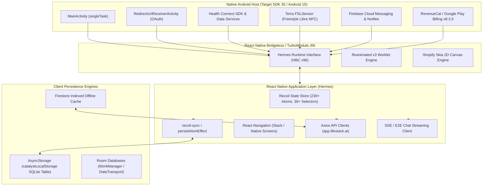
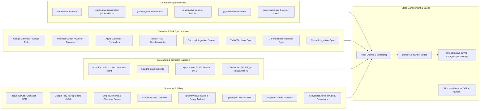
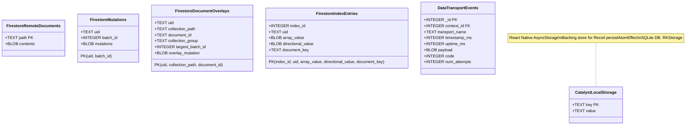
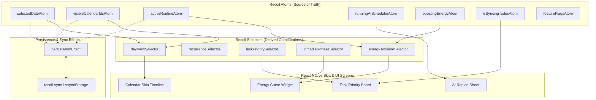
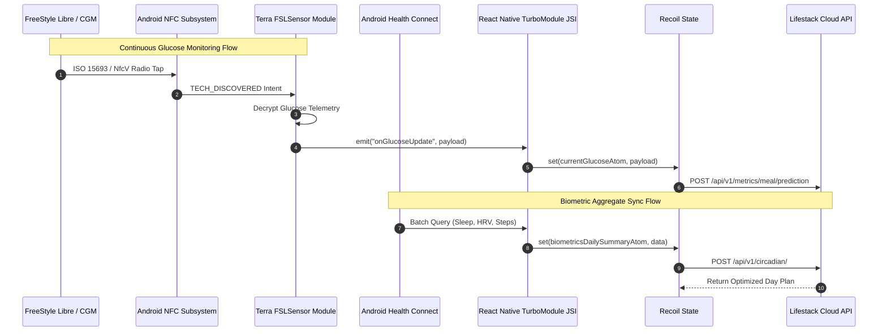

# Architecture & Systems Engineering Analysis: Lifestack Android Target

> **Target**: `Lifestack.apk` (`com.demind.lifestack_calendar`)  
> **Target SHA-256**: `cbb92c670cf0adc1f096fe86b6f3f2feb6397b5efd67073243400e68001fb669`  
> **Extraction Evidence ID**: `ev_670ff1f646ba725229a5a210adc159c72927e37d980da82cb5f480af0da8193f`  
> **Inspection Evidence ID**: `ev_5ccd32579751b11a3c06eec6b1c406f626f36e6ec60338ec3fb02f4a433c5aa8`  
> **Runtime Environment**: React Native 0.73+ (TurboModules / Bridgeless Architecture) on Meta Hermes JavaScript Engine (HBC v96)  
> **Document Purpose**: Complete architectural mapping of modules, IPC interfaces, remote API surface, local database schemas, and state management ahead of code implementation.

---

## 1. Executive Summary & Runtime Profile

Lifestack is an AI-driven calendar, task management, and biometric energy optimization platform developed by Demind, Inc. The Android client operates as a modern hybrid application combining native Kotlin/Java runtime services with a React Native application bundled into optimized Hermes Bytecode.



### Runtime Specifications
- **Package Name**: `com.demind.lifestack_calendar`
- **Application Version**: `2.15.2` (VersionCode `575`)
- **Android SDK Compliance**: Target SDK `35` (Android 15), Min SDK `28` (Android 9.0 Pie), Compile SDK `35`
- **JavaScript Engine**: Meta Hermes VM (Bytecode format version `96`, magic header `0x1f1903c103bc1fc6`, 92,377 interned strings, 49,634 functions)
- **Native Architecture**: Compiled for `arm64-v8a`, `armeabi-v7a`, `x86`, `x86_64` with TurboModules enabled (`react_featureflags.useTurboModules = true`, `react_featureflags.useBridgelessArchitecture = true`).

---

## 2. Module Dependency Graph

The application architecture is decomposed into distinct functional clusters:



### Module Responsibilities
1. **Core Scheduling & Calendar Visualization**: Custom high-performance timeline and canvas renderers powered by `@shopify/react-native-skia` and `react-native-reanimated` for 60fps/120fps continuous calendar drag-and-drop, multi-day zoom, and circadian curve overlays.
2. **Biometrics & Wearable Integration**:
   - `androidx.health.connect:connect-client`: Direct bidirectional interface reading and aggregating Sleep stages, Heart Rate Variability (HRV), Resting Heart Rate, Active/Basal Calories, Steps, Exercise sessions, and Blood Glucose.
   - `co.tryterra.terra.fsl`: Abbott FreeStyle Libre Continuous Glucose Monitor (CGM) direct NFC scanning via `android.nfc.action.TECH_DISCOVERED` filter.
   - Ultrahuman Ring direct scheme invocation (`extrahuman://api/v1/chat`).
3. **Synchronization Core**: Two-way delta-synchronization engines for Google Calendar, Microsoft 365 / Outlook, Apple Reminders, Todoist, ClickUp, Trello, and GitHub Issues.

---

## 3. IPC & Network API Endpoints

### 3.1 Inter-Process Communication (IPC) & Deep Link Schemes

The application registers exported intent filters in `AndroidManifest.xml` capable of launching `MainActivity` and redirect activities from external applications, notifications, and web browsers:

| Scheme / Pattern | Host / Path | Target Component | Purpose |
| :--- | :--- | :--- | :--- |
| `lifestack://` | `*` | `MainActivity` | Standard internal routing and widget callbacks |
| `lifestack://mainactivity` | `*` | `MainActivity` | Default notification and foreground service re-entry |
| `https://lifestack.onelink.me` | Universal Link | `MainActivity` | AppsFlyer attributed onboarding and referral links |
| `msauth://` | `*` | `MainActivity` | Microsoft Entra ID / Outlook Calendar OAuth redirect |
| `com.googleusercontent.apps.21875815912-1mera9q6cajemrl312phrra4nhqbd450://` | `*` | `RedirectUriReceiverActivity` | Google OAuth Client ID 1 authentication callback |
| `com.googleusercontent.apps.243282022402-ebmt9npe1g387i6onqul59k80q4npl8n://` | `*` | `RedirectUriReceiverActivity` | Google OAuth Client ID 2 authentication callback |
| `extrahuman://api/v1/chat` | External Scheme | Ultrahuman Integration | Ultrahuman smart ring biometric chat and session bridge |

### 3.2 Backend Service Infrastructure

- **Primary Production API Host**: `https://app.lifestack.ai`
- **Global Event CloudFront CDN**: `https://da08ctfrofx1b.cloudfront.net`
- **Local Development / Metro Bridge**: `http://localhost:8081`

### 3.3 Remote API Endpoint Taxonomy

#### A. Authentication & User Account Lifecycle (`/api/v1/account`)
- `POST /api/v1/account/auth/signInWithGoogle`: Exchange Google OAuth token for Lifestack session tokens.
- `POST /api/v1/account/auth/callback/apple`: Apple Sign-In authorization code and identity token exchange.
- `GET  /api/v1/account/auth/access-alive`: Session health verification and alive status heartbeat.
- `POST /api/v1/account/auth/refresh`: JWT access token rotation using refresh token.
- `POST /api/v1/account/auth/generateJwt`: Internal JWT minting for delegated microservice requests.
- `GET  /api/v1/account/user/{userId}`: Retrieve user profile, circadian preferences, and feature tier.
- `DELETE /api/v1/account/deleteUser`: Account deprecation and data eradication under GDPR/CCPA.
- `GET/PUT /api/v1/account/devices/{deviceGroupId}/device/{deviceId}`: Mobile/Wearable device registration.
- `PUT  /api/v1/account/devices/{deviceGroupId}/priorities`: Priority ordering of wearable sync sources.
- `GET/PUT /api/v1/account/preference/{preferenceId}`: Circadian rhythm, notification, and schedule configurations.
- `POST /api/v1/account/sharedAccess/{sharedAccessId}`: Delegated calendar sharing and assistant permission management.
- `POST /api/v1/account/subscriptions/stripe/checkout/prepare`: Initiate Stripe customer checkout session.
- `POST /api/v1/account/subscriptions/referral/campaign`: Query and generate referral promotion codes.

#### B. Calendar Operations & Event Scheduling (`/api/v1/calendar`)
- `GET  /api/v1/calendar/events/`: Multi-calendar aggregated event fetch for specified date ranges.
- `GET  /api/v1/calendar/events/allDay/v2025-05-02`: High-speed batch fetch for all-day milestone events.
- `POST /api/v1/calendar/events/sync/google`: Trigger immediate Google Calendar delta sync.
- `POST /api/v1/calendar/events/sync/outlook`: Trigger immediate Microsoft Graph Outlook delta sync.
- `GET  /api/v1/calendar/auth/outlook/authorize`: Generate Microsoft Graph authorization URL.
- `POST /api/v1/calendar/auth/outlook/exchangeToken`: Exchange Outlook OAuth code for Microsoft Graph tokens.
- `GET  /api/v1/calendar/events/locations/autocomplete`: Location autocomplete and travel time estimation.
- `GET  /api/v1/calendar/events/phaseEmasByDate`: Compute exponential moving averages of daily circadian phases.
- `POST /api/v1/calendar/webhook/google/receiveEvent`: Google Cloud Pub/Sub webhook for calendar push notifications.
- `POST /api/v1/calendar/webhook/outlook/subscribe`: Renew Microsoft Graph webhook subscriptions.

#### C. Tasks, Projects & Task Synchronizers (`/api/v1/tasks`)
- `GET/POST /api/v1/tasks/`: Primary task CRUD operations.
- `POST /api/v1/tasks/move-between-projects`: Reassign tasks between boards and project lists.
- `GET  /api/v1/tasks/overdue/visible`: Query overdue tasks scheduled against circadian energy windows.
- `GET/PUT /api/v1/tasks/labels/{taskLabelId}`: Task label color, tagging, and priority metadata.
- `GET/POST /api/v1/tasks/projects/{boardId}`: Project boards and group collection metadata.
- `POST /api/v1/tasks/sync/todoist`: Bidirectional delta-synchronization with Todoist API.
- `POST /api/v1/tasks/sync/clickup`: Bidirectional synchronization with ClickUp tasks and spaces.
- `POST /api/v1/tasks/webhook/clickup/receive`: ClickUp real-time change webhook ingestion.
- `POST /api/v1/tasks/webhook/github/`: GitHub Issues synchronization webhook.
- `POST /api/v1/tasks/webhook/trello/`: Trello card update webhook.

#### D. AI Planner, Energy Engine & Circadian Biometrics (`/api/v1/scheduler`, `/api/v1/metrics`, `/api/v1/energy`)
- `POST /api/v1/scheduler/aiScheduler/v5/replan`: Trigger AI replanning engine when schedule slips occur.
- `GET  /api/v1/scheduler/aiScheduler/v5/stream`: Server-Sent Events (SSE) streaming of schedule updates.
- `POST /api/v1/scheduler/aiScheduler/v6/replan`: Version 6 intelligent multi-factor schedule replanner.
- `GET  /api/v1/scheduler/aiScheduler/v6/stream_url`: Signed WebSocket / SSE endpoint for streaming optimization.
- `POST /api/v1/scheduler/daily_plan/generate/v4`: Automated circadian-aligned day schedule generator.
- `POST /api/v1/scheduler/task_category/predict`: NLP category classification for unscheduled tasks.
- `POST /api/v1/scheduler/task_timing/generate`: Optimal time window prediction based on energy peaks.
- `GET  /api/v1/energy/trend/{dataTrendId}/`: Longitudinal energy curve calculations.
- `GET  /api/v1/circadian/`: Melatonin onset, cortisol awakening, and peak energy curve models.
- `GET  /api/v1/metrics/sleep/{metricId}/prediction`: Predictive sleep score and sleep debt calculation.
- `GET  /api/v1/metrics/heartRate/{metricId}`: Aggregated HR/HRV trends ingested from Health Connect.
- `POST /api/v1/meals/ideal_meals/generate`: Nutrition timing generator to prevent postprandial energy slumps.

#### E. AI Assistant & Conversational Streaming (`/api/v1/chat`)
- `POST /api/v1/chat/generalSession`: Start or resume general conversational AI session.
- `POST /api/v1/chat/end_to_end_streaming/v2025-05-02`: Production streaming conversational endpoint.
- `POST /api/v1/chat/e2e-stream/v4/`: High-performance chunked SSE assistant streaming.
- `GET  /api/v1/chat/{chatId}/histories`: Chat message and recommended action history.
- `POST /api/v1/chat/session/{sessionId}/sync`: Synchronize assistant actions directly into the calendar.

---

## 4. Local Database Schema & Data Persistence

The Android application employs a hybrid local storage paradigm consisting of a key-value SQLite backing store for React Native and multiple native Android Room / SQLite databases.



### 4.1 React Native AsyncStorage Schema (`catalystLocalStorage`)

All React Native JavaScript persistence uses `@react-native-async-storage/async-storage`, which initializes a native SQLite database (`RKStorage` / `AsyncStorage`) with the following DDL:

```sql
CREATE TABLE catalystLocalStorage (
    key   TEXT PRIMARY KEY,
    value TEXT NOT NULL
);
```

#### Key Namespaces & Persisted Payload Structures
1. **Recoil Atoms (`persistAtomEffect`)**:
   - `persistAtomEffect`: Intercepts Recoil state modifications and writes serialized JSON snapshots to `catalystLocalStorage`.
   - Keys include: `@recoil-persist`, `visibleCalendarIdsAtom`, `userPreferencesAtom`, `selectedDateAtom`, `activeRoutineAtom`, `featureFlagsAtom`.
2. **Authentication & Session Tokens**:
   - `userToken`: Signed JWT bearer token for API authorization.
   - `refreshToken`: Token used against `/api/v1/account/auth/refresh`.
   - `userId` / `deviceGroupId`: Local identity handles.
3. **Synchronization State**:
   - `lastSyncTimestamp_google`: Epoch timestamp of last successful Google Calendar sync.
   - `lastSyncTimestamp_outlook`: Epoch timestamp of last successful Outlook sync.
   - `pendingTaskMutations`: Offline task operations queued for synchronization.
4. **Onboarding & Feature State**:
   - `hasCompletedOnboarding`: Boolean flag gating main navigation.
   - `hasConfiguredHealthConnect`: Status of Health Connect permission grant.

### 4.2 Native Room & Firebase Offline Persistence

The APK contains pre-compiled Room SQLite tables in native DEX bytecode (`classes.dex` - `classes5.dex`):

#### Firebase Firestore Offline Cache Engine
| Table Name | Primary Key | Column Definitions | Purpose |
| :--- | :--- | :--- | :--- |
| `bundles` | `bundle_id` | `bundle_id TEXT, create_time_seconds INTEGER, create_time_nanos INTEGER, schema_version INTEGER, total_documents INTEGER, total_bytes INTEGER` | Packaged offline data bundles |
| `remote_documents` | `path` | `path TEXT PRIMARY KEY, contents BLOB` | Cached remote document representations |
| `document_mutations` | `(uid, path, batch_id)` | `uid TEXT, path TEXT, batch_id INTEGER` | Uncommitted mutations pending network flush |
| `document_overlays` | `(uid, collection_path, document_id)` | `uid TEXT, collection_path TEXT, document_id TEXT, collection_group TEXT, largest_batch_id INTEGER, overlay_mutation BLOB` | Optimistic UI mutation overlays |
| `mutation_queues` | `uid` | `uid TEXT PRIMARY KEY, last_acknowledged_batch_id INTEGER, last_stream_token BLOB` | Queue state for Firestore streams |
| `index_configuration` | `index_id` | `index_id INTEGER PRIMARY KEY, collection_group TEXT, index_proto BLOB` | Client-side query index metadata |
| `index_entries` | Composite | `index_id INTEGER, uid TEXT, array_value BLOB, directional_value BLOB, document_key TEXT` | Fast multi-field query index lookups |
| `targets` | `target_id` | `target_id INTEGER PRIMARY KEY, canonical_id TEXT, snapshot_version_seconds INTEGER, snapshot_version_nanos INTEGER, resume_token BLOB, last_listen_sequence_number INTEGER, target_proto BLOB` | Active query listen targets |

#### Google DataTransport (Telemetry & Logging Queue)
- `transport_contexts`: `(_id INTEGER PRIMARY KEY, backend_name TEXT NOT NULL, priority INTEGER NOT NULL, next_request_ms INTEGER NOT NULL)`
- `events`: `(_id INTEGER PRIMARY KEY, context_id INTEGER NOT NULL, transport_name TEXT NOT NULL, timestamp_ms INTEGER NOT NULL, uptime_ms INTEGER NOT NULL, payload BLOB NOT NULL, code INTEGER, num_attempts INTEGER NOT NULL)`
- `event_metadata`: `(_id INTEGER PRIMARY KEY, event_id INTEGER NOT NULL, name TEXT NOT NULL, value TEXT NOT NULL)`
- `event_payloads`: `(sequence_num INTEGER NOT NULL, event_id INTEGER NOT NULL, bytes BLOB NOT NULL)`

---

## 5. State Management Architecture

State is orchestrated using **Facebook Recoil**, adhering to an atomic state graph with fine-grained subscriptions and asynchronous selectors.



### 5.1 Core Recoil Atom Inventory by Domain

| Domain | Atom Identifier | Type / Contract | Persistence |
| :--- | :--- | :--- | :--- |
| **Calendar Core** | `visibleCalendarIdsAtom` | `Set<string>` / `Array<string>` | Yes (`catalystLocalStorage`) |
| **Calendar Core** | `selectedDateAtom` | `string` (`YYYY-MM-DD`) | Yes |
| **Calendar Core** | `todayAtom` | `string` (`YYYY-MM-DD`) | No (In-memory derived) |
| **Scheduler** | `runningAISchedulerAtom` | `boolean` | No (Transient) |
| **Scheduler** | `aiReplan.isRunningAIReplanAtom`| `boolean` | No (Transient) |
| **Scheduler** | `replanRequestIdAtom` | `string` (UUID) | Yes |
| **Scheduler** | `activeRoutineAtom` | `RoutineModel` | Yes |
| **Scheduler** | `scheduledActionsAtom` | `Array<ActionItem>` | Yes |
| **Energy & Circadian**| `boostingEnergyAtom` | `boolean` | No (Transient) |
| **Energy & Circadian**| `selectedEnergyBoostOptionsAtom`| `Array<BoostOption>` | Yes |
| **Energy & Circadian**| `energyboostOptionsTimelineAtom`| `TimelineSlotMap` | No |
| **Tasks & Projects** | `isSyncingTodosAtom` | `boolean` | No (Transient) |
| **Tasks & Projects** | `hasFirstTodoSyncFinishedAtom` | `boolean` | Yes |
| **Tasks & Projects** | `processedIdsAtom` | `Set<string>` | Yes |
| **Assistant & Chat** | `schedulerChatSessionIdAtom` | `string` (Session ID) | Yes |
| **Assistant & Chat** | `chatFeedbackAtom` | `FeedbackStatusMap` | Yes |
| **Navigation & UI** | `currentRouteNameAtom` | `string` | No (Transient) |
| **System & Flags** | `featureFlagsAtom` | `Record<string, boolean>` | Yes |
| **System & Flags** | `autoSaveAtom` | `boolean` | Yes |

### 5.2 Atomic Persistence Pattern (`persistAtomEffect`)

Analysis of Hermes bytecode literals isolates the persistence lifecycle mechanism:
```javascript
// Bytecode Reconstruction: persistAtomEffect
const persistAtomEffect = (key) => ({ setSelf, onSet, trigger }) => {
  if (trigger === 'get') {
    AsyncStorage.getItem(key).then(savedValue => {
      if (savedValue != null) {
        setSelf(JSON.parse(savedValue));
      }
    }).catch(err => console.warn(`[persistAtomEffect] Failed to read persisted value for key "${key}"`));
  }

  onSet((newValue, _, isReset) => {
    if (isReset) {
      AsyncStorage.removeItem(key)
        .catch(err => console.warn(`[persistAtomEffect] Failed to remove persisted value for key "${key}"`));
    } else {
      AsyncStorage.setItem(key, JSON.stringify(newValue))
        .catch(err => console.warn(`[persistAtomEffect] Failed to persist value for key "${key}"`));
    }
  });
};
```

---

## 6. Third-Party Integrations & Wearable Pipeline



### Integrated SDK Catalog
1. **Health Connect (`androidx.health.connect`)**:
   - Accesses standard Android Health Connect permissions (`READ_SLEEP`, `READ_HEART_RATE`, `READ_HEART_RATE_VARIABILITY`, `READ_EXERCISE`, `READ_NUTRITION`, `READ_STEPS`, `READ_TOTAL_CALORIES_BURNED`, `READ_BLOOD_GLUCOSE`).
2. **Terra API SDK (`co.tryterra.terra.fsl.FSLSensor`)**:
   - NFC filter (`android.nfc.tech.NfcV`, `android.nfc.tech.IsoDep`) interfacing directly with Continuous Glucose Monitoring sensors.
3. **RevenueCat Purchases SDK (`com.revenuecat.purchases`)**:
   - Native Google Play Billing 8.3.0 wrapper managing subscription entitlements, trials, and billing verification.
4. **AppsFlyer (`com.appsflyer.referrer`)**:
   - Deep link attribution and install verification via `https://lifestack.onelink.me`.
5. **Firebase Suite (`io.invertase.firebase`)**:
   - FCM messaging, background push wakeup, Cloud Firestore offline synchronization, and remote configuration flags.
6. **Sentry Mobile Telemetry (`io.sentry.android.core`)**:
   - Automated native and JS crash capture, network span tracing, and ANR profiling.

---

## 7. Evidence & Provenance Ledger

| Evidence Claim | Observation / File Source | Binary Offset / Symbol / Digest | Validation Method |
| :--- | :--- | :--- | :--- |
| **Package & Versions** | `AndroidManifest.xml` | Package: `com.demind.lifestack_calendar`, VersionCode: `575`, VersionName: `2.15.2` | AXML Binary Chunk 0x0102 parsed |
| **Target SDKs** | `AndroidManifest.xml` | `targetSdkVersion: 35`, `minSdkVersion: 28` | AXML `<uses-sdk>` attribute scan |
| **Hermes Engine** | `assets/index.android.bundle` | Magic: `0x1f1903c103bc1fc6`, Format Version: `96` | 16-byte file header validation |
| **Hermes String Table** | `assets/index.android.bundle` | String Count: `92,377`, Overflow Count: `141` | Bitfield unpack `(v >> 1) & 0x7FFFFF` |
| **AsyncStorage Schema** | `classes.dex` | `CREATE TABLE catalystLocalStorage (key TEXT PRIMARY KEY, value TEXT NOT NULL)` | Raw DEX string / bytecode scan |
| **Firestore Cache Schema**| `classes.dex` | `bundles`, `remote_documents`, `mutations`, `document_overlays`, `index_entries` | Raw DEX string / bytecode scan |
| **Recoil Atoms** | `assets/index.android.bundle` | `visibleCalendarIdsAtom`, `selectedDateAtom`, `runningAISchedulerAtom`, etc. | Hermes string table pattern extraction |
| **Primary API Host** | `assets/index.android.bundle` | `https://app.lifestack.ai` | Hermes string table URL scan |
| **CloudFront Endpoint** | `assets/index.android.bundle` | `https://da08ctfrofx1b.cloudfront.net` | Hermes string table URL scan |
| **Terra NFC Sensor** | `AndroidManifest.xml` | `co.tryterra.terra.fsl.FSLSensor` & `nfc_tech_filter.xml` | Manifest `<activity-alias>` & meta-data |
| **Health Connect Client** | `classes2.dex` | `androidx.health.connect.client.HealthConnectClient` | DEX class descriptor inspection |

---

## 8. Architectural Inferences & Unknowns

### Confirmed Observations
- The application is a React Native app operating on Hermes bytecode v96 with TurboModules and bridgeless mode activated.
- State is managed via Recoil with atom-level persistence to Android AsyncStorage SQLite (`catalystLocalStorage`).
- Real-time AI chat and replanning use chunked HTTP/SSE streams (`/api/v1/chat/e2e-stream/v4/`, `/api/v1/scheduler/aiScheduler/v6/stream_url`).

### Inferences
- The scheduling solver executes server-side on Demind's cloud backends, while the mobile client acts as an interactive visualization and event staging cache.
- Local biometric data from Health Connect and Terra CGM is transmitted to `/api/v1/metrics/` and `/api/v1/circadian/` to compute personalized daily energy scores and peak productivity curves.

### Known Unknowns / Limitations
- Proprietary heuristic weights for circadian energy curve calculation (`combineEnergy`, `getFocusDailyTrend`) are computed remotely within the backend service and not exposed as client-side logic.
- Hermes bytecode decompilation to full human-readable JavaScript sources would require version-matched HBC v96 disassemblers (`hermes-dec` / custom HBC 96 AST lifter), which is outside the scope of static architectural mapping.

